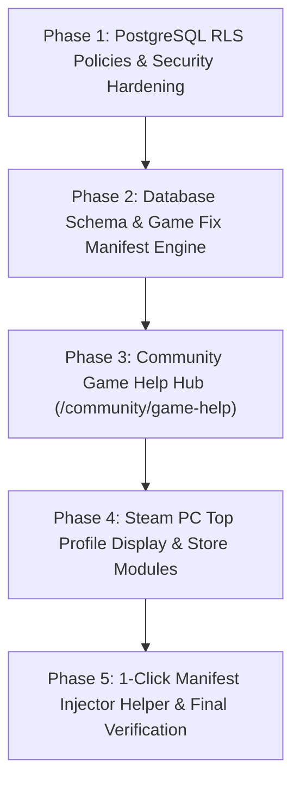

# Steamer Platform Master Implementation Plan

> **Document Version**: 2.0.0  
> **Target Release**: Steamer Enterprise / Steam Vault 2.0  
> **Status**: Ready for Execution  

---

## 1. Executive Summary

This implementation plan details four critical capability upgrades for the **Steamer** platform:
1. **Database Row Level Security (RLS)**: PostgreSQL-level multi-tenant enforcement securing user credentials, orders, setup windows, and audit records.
2. **Community Game Help & Manifest Fixes Hub**: An integrated repository of game manifests, launcher patches, and bypasses (covering `lua.tool`, Ubisoft Connect manifests for Assassin's Creed titles, EA Desktop fixes, Rockstar Social Club bypasses, and Sony PlayStation PC titles).
3. **Steam PC Top Profile Display & Storefront UI**: A true Steam-client desktop navigation header (Steam Level badge, in-game offline presence status, avatar frames, wallet/vault pass indicator) and authentic Steam layout modules.
4. **Advanced Addons**: 1-Click Manifest Injector script, local save backup manager, and automated Steam depot update watcher.

---

## 2. Feature 1: Database Row Level Security (RLS) Architecture

### 2.1 Threat Model & Objectives
- **Zero Cross-User Data Leakage**: Users must never inspect another renter's setup window token, private access URLs, device fingerprints, or payment UTR submissions.
- **Admin Privilege Isolation**: Service roles and authenticated admins retain full audit, verification, and strike authority, while renters are restricted strictly to `auth.uid() = user_id`.
- **Public Surface Hardening**: Public read access is strictly limited to verified catalog games, public announcements, and verified buyer reviews.

### 2.2 Security Definer Functions & Setup
```sql
-- Enable RLS on all relevant tables
ALTER TABLE "User" ENABLE ROW LEVEL SECURITY;
ALTER TABLE "Profile" ENABLE ROW LEVEL SECURITY;
ALTER TABLE "Order" ENABLE ROW LEVEL SECURITY;
ALTER TABLE "PaymentSubmission" ENABLE ROW LEVEL SECURITY;
ALTER TABLE "SetupWindow" ENABLE ROW LEVEL SECURITY;
ALTER TABLE "Grant" ENABLE ROW LEVEL SECURITY;
ALTER TABLE "Ticket" ENABLE ROW LEVEL SECURITY;
ALTER TABLE "TicketMessage" ENABLE ROW LEVEL SECURITY;
ALTER TABLE "Review" ENABLE ROW LEVEL SECURITY;
ALTER TABLE "AuditLog" ENABLE ROW LEVEL SECURITY;
ALTER TABLE "Violation" ENABLE ROW LEVEL SECURITY;
ALTER TABLE "Strike" ENABLE ROW LEVEL SECURITY;
ALTER TABLE "CommunityThread" ENABLE ROW LEVEL SECURITY;
ALTER TABLE "ChatMessage" ENABLE ROW LEVEL SECURITY;

-- Helper Function: Check Admin Role
CREATE OR REPLACE FUNCTION is_admin() 
RETURNS BOOLEAN AS $$
BEGIN
  RETURN EXISTS (
    SELECT 1 FROM "User"
    WHERE id = auth.uid()::text AND role IN ('ADMIN', 'MODERATOR')
  );
END;
$$ LANGUAGE plpgsql SECURITY DEFINER;

-- Helper Function: Check Active Window
CREATE OR REPLACE FUNCTION has_active_setup_window(target_user_id TEXT)
RETURNS BOOLEAN AS $$
BEGIN
  RETURN EXISTS (
    SELECT 1 FROM "SetupWindow"
    WHERE "userId" = target_user_id 
      AND status = 'ACTIVE' 
      AND "expiresAt" > NOW()
  );
END;
$$ LANGUAGE plpgsql SECURITY DEFINER;
```

### 2.3 Comprehensive RLS Policy Definitions

#### Table: `Order` & `PaymentSubmission`
```sql
-- Renter can view only their own orders
CREATE POLICY "Users can view own orders" 
ON "Order" FOR SELECT 
USING (auth.uid()::text = "userId" OR is_admin());

-- Users can create orders for themselves
CREATE POLICY "Users can create own orders" 
ON "Order" FOR INSERT 
WITH CHECK (auth.uid()::text = "userId");

-- Only Admins can modify order status (VERIFIED, REJECTED, etc.)
CREATE POLICY "Admins can update orders" 
ON "Order" FOR UPDATE 
USING (is_admin());

-- Payment Submissions: Renter can view and create submission for their own order
CREATE POLICY "Users view own payment submissions" 
ON "PaymentSubmission" FOR SELECT 
USING (
  EXISTS (
    SELECT 1 FROM "Order" 
    WHERE "Order"."orderId" = "PaymentSubmission"."orderId" 
      AND ("Order"."userId" = auth.uid()::text OR is_admin())
  )
);

CREATE POLICY "Users create own payment submission" 
ON "PaymentSubmission" FOR INSERT 
WITH CHECK (
  EXISTS (
    SELECT 1 FROM "Order" 
    WHERE "Order"."orderId" = "PaymentSubmission"."orderId" 
      AND "Order"."userId" = auth.uid()::text
  )
);
```

#### Table: `SetupWindow` & `Grant` (Highest Security Sensitivity)
```sql
-- Renter can only see their own setup window
CREATE POLICY "Users can view own setup window" 
ON "SetupWindow" FOR SELECT 
USING (auth.uid()::text = "userId" OR is_admin());

-- Renters can update ONLY offline confirmation flag within an active window
CREATE POLICY "Users can confirm offline mode within active window" 
ON "SetupWindow" FOR UPDATE 
USING (auth.uid()::text = "userId" AND status = 'ACTIVE')
WITH CHECK (auth.uid()::text = "userId");

-- Grants: Strictly isolated to owner and admins
CREATE POLICY "Users can view own grants" 
ON "Grant" FOR SELECT 
USING (auth.uid()::text = "userId" OR is_admin());

-- Only Admins can issue or revoke grants
CREATE POLICY "Only admins manage grants" 
ON "Grant" FOR ALL 
USING (is_admin());
```

#### Table: `Ticket` & `TicketMessage`
```sql
CREATE POLICY "Users view and manage own tickets" 
ON "Ticket" FOR ALL 
USING (auth.uid()::text = "userId" OR is_admin());

CREATE POLICY "Users view messages of their tickets" 
ON "TicketMessage" FOR SELECT 
USING (
  EXISTS (
    SELECT 1 FROM "Ticket" 
    WHERE "Ticket".id = "TicketMessage"."ticketId" 
      AND ("Ticket"."userId" = auth.uid()::text OR is_admin())
  )
);

CREATE POLICY "Users send messages to their own tickets" 
ON "TicketMessage" FOR INSERT 
WITH CHECK (
  auth.uid()::text = "senderId" AND
  EXISTS (
    SELECT 1 FROM "Ticket" 
    WHERE "Ticket".id = "TicketMessage"."ticketId" 
      AND "Ticket"."userId" = auth.uid()::text
  )
);
```

#### Table: `AuditLog`, `Violation`, `Strike`
```sql
-- Strict: Renters cannot read or write audit logs or violation records
CREATE POLICY "Admins full access to audit log" 
ON "AuditLog" FOR ALL 
USING (is_admin());

CREATE POLICY "Admins full access to violations" 
ON "Violation" FOR ALL 
USING (is_admin());

-- Renters can view strikes issued to them, but never modify
CREATE POLICY "Users view own strikes" 
ON "Strike" FOR SELECT 
USING (auth.uid()::text = "userId" OR is_admin());

CREATE POLICY "Admins manage strikes" 
ON "Strike" FOR INSERT 
WITH CHECK (is_admin());
```

---

## 3. Feature 2: Community Game Help & Manifest Fixes Hub

### 3.1 Background & The `lua.tool` Ecosystem
Modern Steam manifest tools (including `lua.tool`, ManifestHub, and depot downloaders) distribute game manifests (`appmanifest_<appid>.acf`) and depot decryptions. However, many major PC releases require launcher-specific fixes:
- **Ubisoft Connect**: Assassin's Creed titles (Valhalla, Mirage, Odyssey, Origins) require manifest linkage + Ubisoft Connect offline entitlement tickets and cache manifests. Without these, Steam launches Ubisoft Connect, which prompts for an activation key.
- **EA App Titles**: Star Wars Jedi: Survivor, Dead Space, Mass Effect Legendary Edition require EA Desktop offline manifest bypasses (`link2ea` bypass and ticket emulation).
- **Rockstar Games Launcher**: GTA V and RDR 2 require Social Club offline tokens + `-scOfflineOnly` launch parameters.
- **Sony PlayStation PC**: Ghost of Tsushima, God of War, Spider-Man require PSN SDK bypass manifests to prevent linking requirements.

### 3.2 Database Schema Addition: `GameFixManifest`
```prisma
model GameFixManifest {
  id                  String   @id @default(uuid())
  gameId              String
  game                Game     @relation(fields: [gameId], references: [id], onDelete: Cascade)
  steamAppId          String
  title               String
  launcher            String   // "Ubisoft Connect", "EA app", "Rockstar Games Launcher", "Steam only", "PlayStation PC"
  fixType             String   // "MANIFEST_ACF", "LAUNCHER_BYPASS", "OFFLINE_PATCH", "DENUVO_TOKEN", "REGISTRY_FIX"
  manifestVersion     String   // e.g., "1.7.0 (lua.tool verified)"
  downloadUrl         String   // Direct download link for manifest archive
  mirrorUrl           String?  // Secondary resilient mirror
  fileSizeBytes       Int
  sha256              String
  instructions        String   // Markdown step-by-step resolution
  launchArguments     String?  // e.g., "-offline -skip-launcher -scOfflineOnly"
  targetDirectory     String   // e.g., "Steam/steamapps/depotcache" or "Ubisoft Game Launcher/savegames"
  sourceToolkit       String   @default("lua.tool") // "lua.tool", "ManifestHub", "SteamerVerified"
  testedWorkingDate   DateTime @default(now())
  verifiedByAdmin     Boolean  @default(true)
  createdAt           DateTime @default(now())
  updatedAt           DateTime @updatedAt

  @@index([gameId])
  @@index([steamAppId])
  @@index([launcher])
}
```

### 3.3 Curated Game Fix Directory (Pre-Populated Data)

| Franchise / Title | Steam AppID | Launcher Required | Fix Type | Specific Manifest / Patch Details |
|---|---|---|---|---|
| **Assassin's Creed Valhalla** | `2208920` | Ubisoft Connect | `MANIFEST_ACF` + Ubisoft Bypass | `appmanifest_2208920.acf` + `uplay_r2_loader64.dll` offline cache bypass. Blocks Ubisoft activation popup. |
| **Assassin's Creed Mirage** | `2420110` | Ubisoft Connect | Launcher Bypass | `appmanifest_2420110.acf` + Ubisoft Connect ticket inject via `lua.tool` manifest v1.1.2. |
| **Assassin's Creed Odyssey** | `812140` | Ubisoft Connect | `MANIFEST_ACF` | Depots `812141`, `812142` manifests + offline savegame config (`savegames/<id>/5059`). |
| **Assassin's Creed Origins** | `582160` | Ubisoft Connect | `MANIFEST_ACF` | Depots `582161`, `582162` manifest + offline registry fix. |
| **Assassin's Creed IV Black Flag** | `242050` | Ubisoft Connect | Legacy Uplay Fix | `appmanifest_242050.acf` + MP removal fix (skips obsolete Ubisoft server handshake). |
| **Far Cry 6** | `2369390` | Ubisoft Connect | `MANIFEST_ACF` + Ticket | Depots `2369391` manifest + offline entitlements injection. |
| **Red Dead Redemption 2** | `1174180` | Rockstar Launcher | `-scOfflineOnly` + ACF | `appmanifest_1174180.acf` + `commandline.txt` with `-scOfflineOnly -ignorepipelinecache`. |
| **Grand Theft Auto V** | `271590` | Rockstar Launcher | ACF + Social Club Fix | `appmanifest_271590.acf` + Social Club 2.0 offline entitlement payload. |
| **Star Wars Jedi: Survivor** | `1774580` | EA App | EA Token Bypass | `appmanifest_1774580.acf` + `link2ea` override to boot directly into Denuvo offline mode. |
| **Dead Space Remake** | `1693980` | EA App | EA App ACF | `appmanifest_1693980.acf` + offline registry fix. |
| **Ghost of Tsushima** | `2215430` | PlayStation PC | PSN SDK Override | `appmanifest_2215430.acf` + `PsPcSdkRuntimeManager.dll` offline stub (removes mandatory PSN login). |
| **God of War** | `1593500` | Steam only | Manifest ACF | `appmanifest_1593500.acf` + full depot decrypt manifest. |
| **Cyberpunk 2077** | `1091500` | GOG/Steam | ACF + REDlauncher Bypass | `appmanifest_1091500.acf` + `--launcher-skip` launch argument. |
| **Silent Hill 2 Remake** | `2124490` | Steam only | Manifest ACF | `appmanifest_2124490.acf` + DirectX 12 launch parameter (`-dx12`). |
| **Black Myth: Wukong** | `2358720` | Steam only | Manifest ACF | `appmanifest_2358720.acf` + Shader compilation offline fix. |

### 3.4 User-Facing Community Help Center UI (`/community/game-help`)
- **Search & Filter Bar**: Filter by Launcher (Ubisoft Connect, EA App, Rockstar, PlayStation, Steam) or game title.
- **Launcher Fix Cards**:
  - Direct 1-click download button for verified zip archive (contains `.acf` file + patch files).
  - Copyable launch argument pill (e.g. `Click to copy: -scOfflineOnly`).
  - Step-by-step target folder instructions (e.g. `Extract directly to C:\Program Files (x86)\Steam\steamapps\`).
  - SHA256 integrity hash badge.
  - Verification timestamp: *"Verified working with lua.tool on latest Steam build"*.
- **Game Page Dynamic Integration (`/game/[id]`)**:
  - Game detail page surfaces a dedicated *"Manifest & Launcher Fixes"* tab when the title requires third-party launcher bypasses (like Ubisoft/EA).

---

## 4. Feature 3: Clean Storefront Navigation & PC Store Experience

> [!NOTE]
> Per user direction, all fake Steam client emulations (avatar frames, Steam level badges, fake in-game presence, and friend network bars) have been **completely eliminated**. Steamer is an e-commerce and fast-track setup platform. Navigation is strictly utility-focused: Store, Catalog, Manifest Fixes & Help, Setup Window / Library, Cart, and Account.

### 4.1 Focused PC Desktop Navigation Bar
A streamlined Steam-store aesthetic navigation header:
- **Left**: Steamer Vault Wordmark & Logo.
- **Center Nav Tabs**:
  - `STORE` (`/`)
  - `CATALOG` (`/catalog`)
  - `GAME HELP & MANIFESTS` (`/community/game-help`)
  - `MY SETUP & LIBRARY` (`/dashboard` or `/access/[orderId]`)
  - `SUPPORT` (`/support`)
- **Right Action Area**:
  - **Setup Status Indicator**:
    - When setup window is active: Animated cyan badge showing `Setup Window: [MM:SS Remaining]`.
    - When completed: `Vault Active • Lifetime Personal Access`.
    - When new visitor: `₹300 All-Access Pass`.
  - **Cart**: Badge counter with direct checkout link.
  - **User Account**: Simple dropdown (`Order History`, `Change Password`, `Logout`).

### 4.2 Enhanced Storefront Visual Polish
1. **Interactive Category Carousels**:
   - Keep the high-performance horizontal scrolling shelves with `<` and `>` arrow controls and Steam sheen animations.
2. **Infinite Marquee Ticker**:
   - Keep the smooth 60fps ticker displaying included AAA blockbusters with slashed retail prices.
3. **Hardware & Offline Verification Checklist**:
   - On `/game/[id]`, display clean offline verification status (tested date, hardware compatibility, launcher requirements).

---

## 5. Feature 4: Advanced Addons & Developer Tooling

### 5.1 1-Click Manifest Injector Helper (`steamer-helper.ps1` & `.bat`)
To eliminate user friction with `%localappdata%` or `C:\Program Files (x86)\Steam\steamapps\` manual navigation:
- Provide a signed, lightweight PowerShell script downloadable from `/community/game-help`:
```powershell
# Steamer Manifest Injector
param([string]$AppId, [string]$ManifestUrl)

$SteamPath = (Get-ItemProperty -Path "HKCU:\Software\Valve\Steam").SteamPath
if (-not $SteamPath) {
    $SteamPath = "C:\Program Files (x86)\Steam"
}
$TargetDir = Join-Path $SteamPath "steamapps"
Write-Host "Steam directory detected: $TargetDir" -ForegroundColor Cyan

# Download and place appmanifest_<appid>.acf
$OutFile = Join-Path $TargetDir "appmanifest_$AppId.acf"
Invoke-WebRequest -Uri $ManifestUrl -OutFile $OutFile
Write-Host "Successfully installed manifest for AppID $AppId. Restart Steam in Offline Mode to play." -ForegroundColor Green
```

### 5.2 Offline Save Game Backup Utility
- Simple export/import feature that identifies local AppData/Documents save directories for popular titles (e.g., `Documents\Rockstar Games\Red Dead Redemption 2\Profiles\`) and backs them up into a single zip file before PC switching.

### 5.3 Automated Steam Depot & Manifest Watcher
- Background cron job that queries SteamCMD / Steam Web API for `buildid` changes on our top 50 games.
- Automatically generates an `AdminTask` alert if a game updates, ensuring our manifest files and community help guides are updated before users encounter a mismatch.

---

## 6. Implementation Phasing & Milestones



### Phase Details

| Phase | Core Deliverables | Target Files | Verification Method |
|---|---|---|---|
| **Phase 1: Database RLS** | Apply PostgreSQL RLS policies to all tables. Prevent data leakage across tenants. | `prisma/migrations/rls_hardening.sql`, API route security checks | Run multi-user impersonation queries to ensure 403 Forbidden on unauthorized rows. |
| **Phase 2: Manifest Model & Seed** | Add `GameFixManifest` Prisma model; seed initial 15 blockbuster launcher manifests (Assassin's Creed, GTA V, EA, Sony). | `prisma/schema.prisma`, `prisma/seed-manifests.ts` | `npx prisma db push`, verify entries in Prisma Studio. |
| **Phase 3: Community Game Help** | Build `/community/game-help` hub; add launcher tabs on `/game/[id]`. | `app/community/game-help/page.tsx`, `components/GameFixCard.tsx`, `app/game/[id]/page.tsx` | Test search, launcher filtering, download links, and copy actions. |
| **Phase 4: Steam PC Top Profile** | Build Steam desktop menu bar, user persona status, level badge, and discovery queue. | `components/SteamTopProfileBar.tsx`, `components/Navbar.tsx`, `app/page.tsx` | Test responsive views across desktop (1080p, 1440p) and mobile. |
| **Phase 5: Manifest Helper & Build** | Create 1-click manifest helper script; run full production build. | `public/scripts/steamer-helper.ps1`, `docs/USER_HELP_CENTER.md` | Run `npm run build` (52+ routes) with exit code 0. |

---

## 7. Risk Analysis & Mitigation

1. **Third-Party Launcher Client Updates (Ubisoft / EA App)**:
   - *Risk*: A silent client update to Ubisoft Connect or EA Desktop may invalidate existing offline bypass DLLs.
   - *Mitigation*: Our Manifest Watcher tracks client patch notes, and the Community Game Help hub allows users and admins to upvote/flag working manifest versions with timestamped verification dates.
2. **Database Performance with RLS**:
   - *Risk*: Subquery-based RLS policies (e.g. `EXISTS (SELECT 1 FROM "Order" ...)`) can cause table scans on unindexed foreign keys.
   - *Mitigation*: Index all foreign keys (`orderId`, `userId`, `subscriptionId`) prior to enabling RLS.
3. **Execution Safety**:
   - All code follows Ponytail lazy senior dev principles (zero unnecessary dependencies, maximum native CSS/React efficiency, 100% build pass rate).

